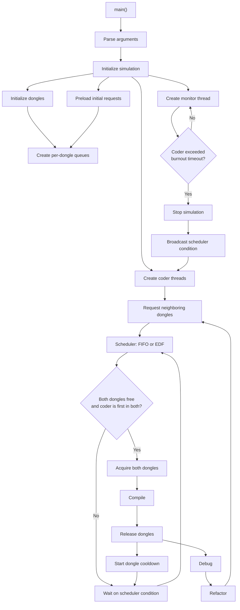
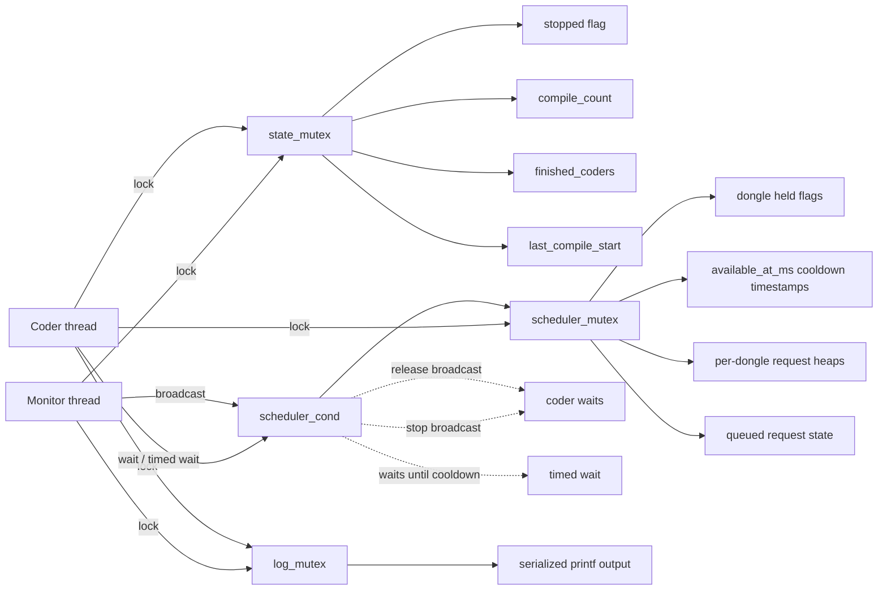

_This project has been created as part of the 42 curriculum by juliatav_

## Description

**Codexion** is a concurrency simulation inspired by the classic philosophers problem, written in C with POSIX threads. Here `number_of_coders` coders sit in a circle with one USB dongle between each pair of neighbours. Each coder cycles through compiling, debugging and refactoring. 

Compiling requires holding both neighbouring dongles at once. A coder who doesn't compile  for `time_to_burnout` ms burns out, after compiling, dongles must cooldown for `time_to_cooldown` ms. The simulation ends when every coder has compiled `number_of_compiles_required` times or when a coder burns out.

If two or more coders request the same dongle, it should be granted according to a scheduler (`fifo` or `edf`) backed by a hand-written priority queue (heap).

## Instructions

**Compile:**

    make

**Run:**

    ./codexion number_of_coders time_to_burnout time_to_compile time_to_debug \
               time_to_refactor number_of_compiles_required dongle_cooldown scheduler

All times are in milliseconds. `scheduler` is `fifo` or `edf`.

**Example:**

    ./codexion 5 900 200 200 200 7 50 edf

Other rules: `make clean`, `make fclean` and `make re`. Builds with `cc -Wall -Wextra -Werror -pthread`.
**Example output:**

```
    $ ./codexion 2 10000 200 300 500 2 800 fifo
    1 1 has taken a dongle
    2 1 has taken a dongle
    2 1 is compiling
    202 1 is debugging
    502 1 is refactoring
    1026 2 has taken a dongle
    1026 2 has taken a dongle
    1026 2 is compiling
    1226 2 is debugging
    1526 2 is refactoring
    2050 1 has taken a dongle
    2050 1 has taken a dongle
    2051 1 is compiling
    3058 2 has taken a dongle
    3058 2 has taken a dongle
    3058 2 is compiling
```

## Project's structure:


## Blocking cases handled

- **Deadlock prevention (atomic pair acquisition):** a coder can acquire its two neighbouring dongles only when both are free and the coder is first in both dongles’ queues. The pair is marked held together under the scheduler mutex, so a coder never holds one dongle while waiting for the other. `take_dongles` orders the dongles by ID, but acquisition is atomic rather than one-at-a-time.
- **Scheduler ordering and deterministic startup:** each dongle has a priority queue of waiting coders. With `fifo`, the earliest queued request wins. With `edf`, the earliest deadline (`last_compile_start + time_to_burnout`) wins, with queue arrival order breaking ties. Before coder threads start, the program preloads requests in a fixed order—odd-numbered coders, then even-numbered coders—so the initial queue order does not depend on thread startup timing. Each coder must be first in both queues to acquire its pair.
- **Cooldown handling:** releasing a dongle records its next available time. A coder that is first in both queues and has both dongles free waits with `pthread_cond_timedwait` until the later cooldown expires; otherwise, it waits for a scheduler-condition broadcast.
- **Burnout detection:** a separate monitor checks coders approximately every 0,5 ms. When a coder’s time since its last compile start exceeds `time_to_burnout`, the monitor stops the simulation, prints the burnout line, and wakes threads waiting on the scheduler condition variable. Detection timing can also depend on thread scheduling.
- **Log serialization:** every status message is printed under `log_mutex`. Status printing checks whether the simulation has stopped and suppresses regular messages if it has; the monitor prints the burnout message.
- **Single coder:** with one coder, there is only one dongle, so the coder cannot acquire a pair. It attepts to take the dongle, but never gets it since, the implementation only allows to acquire both at once, then waits for the monitor to detect burnout.

## Thread synchronization mechanisms

- `pthread_mutex_t` (shared scheduler mutex): protects both dongles’ shared queue state, held flags, cooldown timestamps, and access to the per-dongle waiting heaps. Coder pair acquisition is handled under this mutex: a coder queues on both dongles, verifies that it is first in both heaps and that both dongles are free, then marks both as held together.
- `pthread_cond_t` (shared scheduler condition variable): coders wait on `scheduler_cond instead of busy-waiting`. Dongle releases and `wake_everyone` broadcast on this condition variable, while `pthread_cond_timedwait` handles waiting until a dongle cooldown has expired.
- `state_mutex:` protects the stopped flag, each coder’s `last_compile_start` and `compile_count`, and `finished_coders`. All access goes through the `get_*/set_*` helpers or explicit lock/unlock calls when multiple operations must be performed together.
- `log_mutex`: serializes status output and prevents messages from interleaving. Normal status messages are suppressed once the simulation has stopped, while the burnout message is still allowed to print.
- **Coder ↔ monitor communication:** the monitor reads coder state under `state_mutex`. To stop the simulation, it sets stopped under that mutex, prints the burnout message, and then broadcasts on `scheduler_cond` through `wake_everyone` so waiting coder threads can exit.
- **Wrappers around the POSIX API:** raw pthread_* calls are kept out of the main code and centralized in wrapper functions. Mutex operations go through `handle_mutex(mutex, LOCK | UNLOCK | INIT | DESTROY)`, thread operations use `handle_thread`, and `get_current_time` centralizes time retrieval.
- Shared values are accessed through small helper functions (`get_bool`, `set_bool`, `get_llong`, and `set_llong`), which acquire the relevant mutex, perform the read or write, and release the mutex. For critical sections involving multiple operations, such as `acquire_dongles`, explicit `handle_mutex(..., LOCK/UNLOCK)` calls are used instead. Every exit path releases the mutex before returning.

### POSIX threads
- https://medium.com/@techdhaba.training/posix-threads-pthreads-the-simplest-way-to-understand-real-multithreading-in-c-c2f591ab7a03
- https://www.youtube.com/watch?v=d9s_d28yJq0&list=PLfqABt5AS4FmuQf70psXrsMLEDQXNkLq2&pp=0gcJCR0Ga94AFGB0
- PTHREADS(7) Linux Programmer's Manual - POSIX threads
- USLEEP(3) Linux Programmer's Manual
- GETTIMEOFDAY(2) Linux Programmer's Manual 

### Dining philosophers problem
- https://medium.com/@jalal92/the-dining-philosophers-7157cc05315
- https://www.youtube.com/watch?v=zOpzGHwJ3MU

### Heap in C
- https://nkugwamarkwilliam.medium.com/heap-in-c-programming-made-easy-e84a8b423660

### Use of AI
AI tools were used as development support to clarify aspects of the POSIX threads API, investigate implementation issues, and improve the wording and formatting of this README. 
The project’s architecture, algorithms, and implementation were developed and reviewed by the author. AI-generated suggestions were treated as assistance and were tested and adapted where appropriate.
